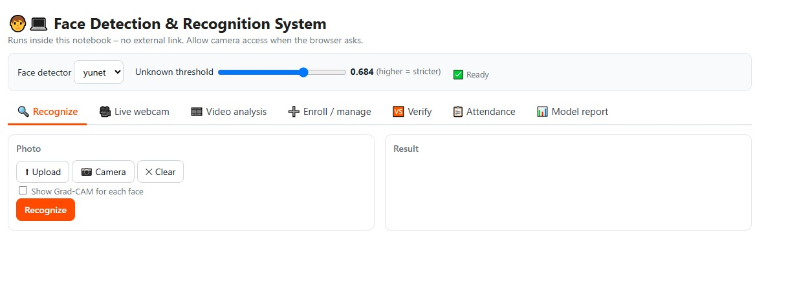
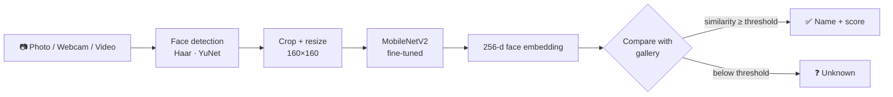

# 🧑‍💻 Face Detection & Recognition System

### Deep Learning case study · MobileNetV2 transfer learning · Open‑set recognition · Interactive GUI


[**Open in Colab**](https://colab.research.google.com/github/VishnuNeha/Face-Detection-Recognition-System/blob/main/Face_Detection_and_Recognition_System.ipynb) ·
[**Results**](#-results) ·
[**Features**](#-features) ·
[**How to run**](#-how-to-run)


</div>

---

## 📖 Overview

An end‑to‑end face recognition pipeline built for the **23ELC364 – Deep Learning** case study. It detects faces in photos, webcam or video, converts each face into a 256‑number embedding with a fine‑tuned **MobileNetV2**, and then either names the person or says **"Unknown"**. New people can be enrolled **without retraining**.

Five models are compared on **LFW (Labeled Faces in the Wild)** using ablations, significance tests, robustness checks and explainability tools, and the best model is exported to **TensorFlow Lite** for deployment.

## 🧠 Pipeline



## ✨ Features

| Area | What is included |
|---|---|
| 🏗️ **Models** | Basic CNN · Improved CNN · VGG16 · MobileNetV2 · MobileNetV2 + ArcFace, with an ablation study |
| 📊 **Evaluation** | Accuracy, macro‑F1, confusion matrix, 95 % confidence intervals, McNemar significance test |
| 🔍 **Explainability** | Feature maps, **Grad‑CAM** heatmaps, **t‑SNE** map of embeddings |
| 🛡️ **Robustness** | Test‑time augmentation, accuracy under darkness, blur, noise, low resolution, sunglasses and mask |
| 🌍 **Real‑world use** | Unknown‑person rejection · enroll new people **without retraining** · face verification · official LFW 6,000‑pair benchmark |
| 🚀 **Deployment** | Per‑image latency, **TFLite INT8** (≈ 3.7× smaller), laptop app (`app.py`) |
| 🖥️ **GUI (in the notebook)** | Recognize photos · live webcam · video analysis · enroll via files or webcam · verify · attendance with CSV export · model report |
| 💾 **Memory** | Enrolled people and attendance are saved to Google Drive and reused in later sessions |

## 🗂️ Dataset

**[LFW – Labeled Faces in the Wild](http://vis-www.cs.umass.edu/lfw/)**: 13,233 photos of 5,749 people with real‑world lighting, pose and background.

* **Known people:** the 12 people with ≥ 50 photos → **1,560 images**
* **Strangers / new people:** the other 5,737 people, never used in training. They are used for unknown‑detection, enrollment and verification.

## 🔎 Face detection

| Detector | Type | Notes |
|---|---|---|
| **Haar Cascade** (Viola–Jones) | Classical | Fast on CPU, used to build the training crops (≈ 21–30 ms/photo) |
| **YuNet** | Tiny CNN (~75k params) | Better with turned heads and bad lighting; a learned **crop calibration** matches its boxes to Haar crops |

## 📈 Results

Test‑set results, single seed (`QUICK_MODE = True`):

| Model | Accuracy (%) | Macro‑F1 (×100) | Parameters | Size (MB) |
|---|---:|---:|---:|---:|
| Basic CNN | 89.3 | 85.4 | 2.96 M | 11.9 |
| Improved CNN (BN + Dropout + Aug) | 33.3 | 5.6 | 0.11 M | 0.5 |
| VGG16 fine‑tuned | 49.1 | 38.4 | 17.99 M | 72.0 |
| MobileNetV2 – frozen only | 81.2 | 77.2 | 2.59 M | 10.4 |
| **MobileNetV2 (selected)** | **90.6** | **87.6** | 2.59 M | 10.4 |
| MobileNetV2 + ArcFace | 88.9 | 86.2 | 2.59 M | 10.4 |

**Selected model:** 90.6 % accuracy (95 % CI 86.8 – 94.0), **91.5 % with test‑time augmentation**.

### Highlights

| Experiment | Outcome |
|---|---|
| Fine‑tuning vs frozen backbone | **+10.4** macro‑F1 points |
| MobileNetV2 vs VGG16 | 87.6 vs 38.4 macro‑F1 with ~7× fewer parameters (McNemar *p* = 2.8e‑23) |
| MobileNetV2 vs Basic CNN | +2.2 macro‑F1, **not statistically significant** (*p* = 0.73) |
| Class weights | +1.1 macro‑F1 |
| Detector choice | Haar 90.6 % · YuNet 88.9 % · YuNet calibrated 88.5 % |
| Embedding quality (nearest centroid) | ImageNet only 67.1 % → softmax 88.0 % → ArcFace 89.3 % |
| Unknown detection | AUC 0.876 · known people correct 74.8 % · strangers wrongly accepted 14.0 % |
| Verification (unseen people) | AUC 0.811 · EER 26.9 % |
| TFLite INT8 | 10.9 MB → **2.9 MB**, accuracy 91.9 % |

### Honest observations

* The **Improved CNN failed to train** in this run (33.3 %), so it is not a fair measure of what augmentation or BatchNorm can do.
* Data augmentation slightly **lowered** macro‑F1 (−2.0) in a single seed. Running 3 seeds (`QUICK_MODE = False`) gives a more reliable ablation.
* Transfer learning's gain over the Basic CNN is small on this 12‑person dataset.
* Open‑set performance is moderate: a fixed 60 % softmax threshold accepts 54 % of strangers, while the calibrated cosine threshold accepts 14 %.

## 🚀 How to run

### Option A: Google Colab (recommended)

1. Click the **Open in Colab** badge at the top.
2. `Runtime → Change runtime type → T4 GPU`.
3. `Runtime → Run all` (≈ 40 min; set `QUICK_MODE = True` in the first cell for ≈ 15 min).
4. Click **Allow** on the Google Drive pop‑up so enrolled people are remembered.
5. The GUI opens inside the notebook (Section 21).

### Option B: Local machine

```bash
git clone https://github.com/VishnuNeha/Face-Detection-Recognition-System.git
cd Face-Detection-Recognition-System
python -m venv .venv && source .venv/bin/activate      # Windows: .venv\Scripts\activate
pip install -r requirements.txt
jupyter notebook Face_Detection_and_Recognition_System.ipynb
```

> The in‑notebook GUI uses Colab callbacks. Locally, run the trained bundle with `app.py` (exported in Section 18).
> Set `USE_GOOGLE_DRIVE = False` in the first cell when not using Colab.

## 📁 Repository structure

```
├── Face_Detection_and_Recognition_System.ipynb   # full project: training, evaluation, GUI
├── README.md
├── requirements.txt
├── .gitignore
├── figures/                                      # plots generated by the notebook
└── assets/                                       # demo GIF / screenshots
```

## ⚠️ Limitations and ethics

* Only **12 known people** and ~1,100 training photos, so results do not generalise to large‑scale recognition.
* LFW is biased toward public figures, which limits demographic diversity.
* Face data is personal data. Only enroll people who have given consent, and follow the applicable law (for example India's DPDP Act, 2023).
* This is an educational project, **not** suitable for security or surveillance use.

## 📚 References

1. Huang et al., *Labeled Faces in the Wild*, UMass Amherst TR 07‑49, 2007
2. Viola & Jones, *Rapid Object Detection using a Boosted Cascade of Simple Features*, CVPR 2001
3. Wu et al., *YuNet: A Tiny Millisecond‑level Face Detector*, MIR 2023
4. Sandler et al., *MobileNetV2*, CVPR 2018
5. Simonyan & Zisserman, *VGG*, ICLR 2015
6. Deng et al., *ArcFace*, CVPR 2019
7. Selvaraju et al., *Grad‑CAM*, ICCV 2017
8. van der Maaten & Hinton, *t‑SNE*, JMLR 2008

## 🙋 Author

**Natti Vishnu Neha** · [GitHub](https://github.com/VishnuNeha) · [LinkedIn](https://linkedin.com/in/natti-vishnu-neha/)

If this helped you, please ⭐ the repo!
